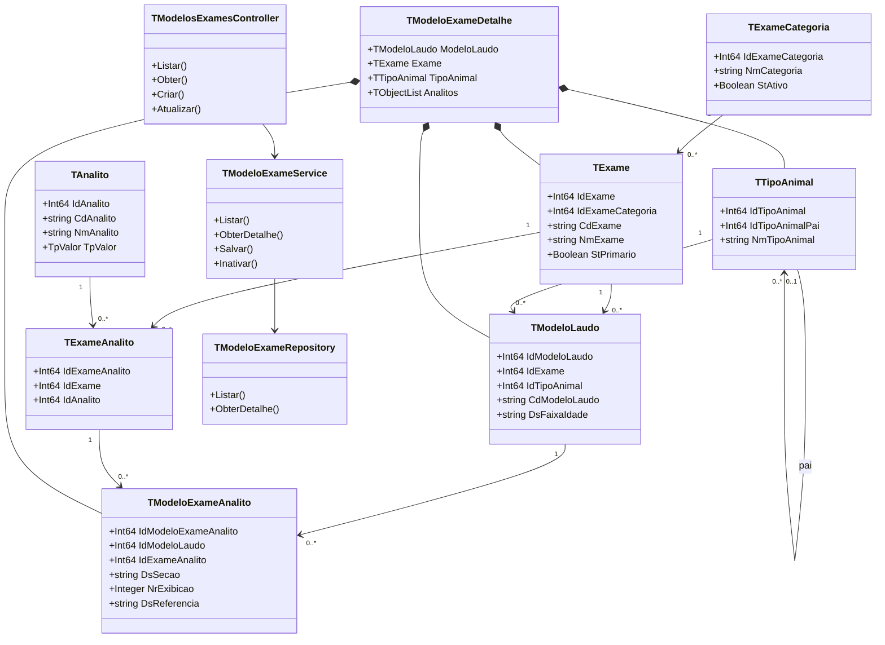

# Especificação — backend de modelos de exames

## Objetivo

Disponibilizar o backend do cadastro de exames e de seus modelos de laudo. O módulo deve permitir consultar, criar, alterar e inativar o catálogo, os tipos de animais, os modelos de laudo e os parâmetros exibidos em cada modelo.

O nome correto da entidade é `tiposanimais`.

## Entidades do domínio

| Entidade | Responsabilidade | Relações principais |
| --- | --- | --- |
| `TExameCategoria` | Agrupa os exames do catálogo. | Possui vários `TExame`. |
| `TExame` | Exame comercial ou pacote. | Pertence a uma categoria; pode referenciar um exame-pai; possui analitos e modelos. |
| `TTipoAnimal` | Agrupamento operacional do laboratório. | Possui hierarquia opcional e classifica modelos de laudo. |
| `TModeloLaudo` | Modelo aplicável a um exame e, opcionalmente, a um tipo de animal/faixa etária. | Possui vários parâmetros configurados. |
| `TAnalito` | Parâmetro laboratorial reutilizável. | Participa de vários exames. |
| `TExameAnalito` | Vínculo base entre exame e analito. | É a ponte N:N e é configurado em modelos. |
| `TModeloExameAnalito` | Apresentação e referência do analito dentro de um modelo. | Pertence a um `TModeloLaudo` e referencia um `TExameAnalito`. |

## Agregado retornado pela tela Modelo de Exames

A tela não deve montar relações no cliente. O endpoint de detalhe retornará `TModeloExameDetalhe`, que reúne as entidades necessárias para exibir e editar um modelo completo.

```text
TModeloExameDetalhe
├── ModeloLaudo: TModeloLaudo
├── Exame: TExame
│   └── Categoria: TExameCategoria
├── TipoAnimal: TTipoAnimal (opcional)
└── Analitos: TObjectList<TModeloExameAnalitoDetalhe>
    ├── Configuracao: TModeloExameAnalito
    ├── VinculoExame: TExameAnalito
    └── Analito: TAnalito
```

As coleções serão representadas por `TObjectList<T>` no domínio e por arrays JSON no contrato HTTP. `TModeloExameDetalhe` deve ser o único objeto composto exposto para criação, alteração e detalhe de um modelo.

## Classes de modelo

Cada classe ficará em uma unit própria em `backend/src/models` e terá `ToJSON` e `FromJSON` quando fizer parte de entrada ou saída da API.

| Unit | Classe | Campos essenciais |
| --- | --- | --- |
| `LabVet.Models.ExameCategoria` | `TExameCategoria` | `IdExameCategoria`, `NmCategoria`, `StAtivo`. |
| `LabVet.Models.Exame` | `TExame` | `IdExame`, `IdExameCategoria`, `CdExame`, `NmExame`, `QtTotalExames`, `VlExame`, `StPrimario`, `IdExamePai`, `StAtivo`, `Categoria`. |
| `LabVet.Models.TipoAnimal` | `TTipoAnimal` | `IdTipoAnimal`, `IdTipoAnimalPai`, `NmTipoAnimal`, `DsDescricao`, `StAtivo`, `Filhos`. |
| `LabVet.Models.ModeloLaudo` | `TModeloLaudo` | `IdModeloLaudo`, `IdExame`, `IdTipoAnimal`, `CdModeloLaudo`, `NmModeloLaudo`, `DsFaixaIdade`, `NmArquivoOrigem`, `StAtivo`. |
| `LabVet.Models.Analito` | `TAnalito` | `IdAnalito`, `CdAnalito`, `NmAnalito`, `DsTecnica`, `DsUnidadeMedida`, `TpValor`, `StAtivo`. |
| `LabVet.Models.ExameAnalito` | `TExameAnalito` | `IdExameAnalito`, `IdExame`, `IdAnalito`, `StAtivo`. |
| `LabVet.Models.ModeloExameAnalito` | `TModeloExameAnalito` | `IdModeloExameAnalito`, `IdModeloLaudo`, `IdExameAnalito`, `DsSecao`, `NrExibicao`, `DsRotulo`, `DsTecnica`, `DsUnidadeMedida`, `DsReferencia`, `VrRefMinimo`, `VrRefMaximo`, `StAtivo`. |
| `LabVet.Models.ModeloExame` | `TModeloExameDetalhe`, `TModeloExameAnalitoDetalhe` | Agregado e itens compostos usados pelo controlador. |

`TpValor` será um tipo enumerado no Delphi: `Inteiro = 1`, `Decimal = 2`, `Caractere = 3` e `Misto = 4`.

## Arquitetura do backend

```text
Controller HTTP
     ↓
Service de domínio e transação
     ↓
Repositories por entidade
     ↓
PostgreSQL / esquema labvet
```

### Repositories

- `TExameCategoriaRepository`: listar, buscar por ID, inserir, atualizar e inativar categorias.
- `TExameRepository`: operações do catálogo, consulta por código e busca com categoria.
- `TTipoAnimalRepository`: consulta plana, consulta em árvore e manutenção da hierarquia.
- `TAnalitoRepository`: consulta por código/nome, manutenção e inativação de analitos.
- `TExameAnalitoRepository`: localiza ou cria o vínculo único `IdExame + IdAnalito`.
- `TModeloLaudoRepository`: lista modelos, busca o cabeçalho e grava o modelo.
- `TModeloExameAnalitoRepository`: lista e persiste os itens ordenados de cada modelo.
- `TModeloExameRepository`: repositório de leitura do agregado; monta o detalhe com joins, sem regra de negócio.

### Services

- `TExameCategoriaService`, `TExameService`, `TTipoAnimalService` e `TAnalitoService`: validações de campos obrigatórios, unicidade e inativação.
- `TModeloExameService`: orquestra criação e edição de `TModeloExameDetalhe` em uma transação.

Ao salvar um modelo, `TModeloExameService` deverá:

1. Validar o exame, o tipo de animal e a faixa etária informada.
2. Inserir ou atualizar `modeloslaudos`.
3. Para cada item, validar o analito e localizar/criar `exameanalitos`.
4. Salvar `modeloexameanalitos`, garantindo ordem única por modelo e faixa numérica coerente quando presente.
5. Inativar itens removidos da edição, sem exclusão física.
6. Registrar o evento em `auditoriaeventos`.

### Controllers e rotas

| Controlador | Rotas iniciais |
| --- | --- |
| `TExameCategoriasController` | `GET/POST /api/v1/examecategorias`, `GET/PUT/PATCH /api/v1/examecategorias/:id` |
| `TExamesController` | `GET/POST /api/v1/exames`, `GET/PUT/PATCH /api/v1/exames/:id` |
| `TTiposAnimaisController` | `GET /api/v1/tiposanimais`, `GET /api/v1/tiposanimais/arvore`, `POST/PUT/PATCH` para manutenção |
| `TAnalitosController` | `GET/POST /api/v1/analitos`, `GET/PUT/PATCH /api/v1/analitos/:id` |
| `TModelosExamesController` | `GET /api/v1/modelosexames`, `GET /api/v1/modelosexames/:id`, `POST /api/v1/modelosexames`, `PUT /api/v1/modelosexames/:id`, `PATCH /api/v1/modelosexames/:id/ativo` |

Os controladores recebem e devolvem JSON, traduzem erros conhecidos para `400`, `404` ou `409` e delegam regras e transações aos services.

## Regras e validações

- `CdExame`, `CdAnalito` e `CdModeloLaudo` são únicos.
- Um `TExameAnalito` é único por exame e analito.
- `NrExibicao` é único por modelo de laudo e deve ser maior que zero.
- `VrRefMinimo` não pode ser maior que `VrRefMaximo`; referências livres permanecem em `DsReferencia`.
- `DsSecao` é opcional e identifica a parte visual/clínica do laudo, como Eritrograma, Leucograma ou Sedimentoscopia.
- Não haverá exclusão física das entidades do módulo; a remoção funcional será por `StAtivo`.
- Modelos históricos sem exame comercial mapeado podem ser consultados, mas não receberão novos itens até que o exame seja associado.
- A composição definitiva de pacotes continua fora deste escopo: `IdExamePai` é somente uma hierarquia temporária e não substitui uma futura tabela associativa de composição.

## Critérios de aceite da primeira entrega

- A API lista categorias, exames, tipos de animais, analitos e modelos ativos.
- A rota de detalhe retorna o agregado `TModeloExameDetalhe` com analitos ordenados.
- É possível criar e editar um modelo com seus analitos em uma única requisição transacional.
- Uma falha em qualquer item não grava parcialmente o cabeçalho ou os parâmetros.
- A inativação impede novos usos, preservando o histórico.
- Operações de criação, alteração e inativação ficam registradas em `auditoriaeventos`.

## Situação atual e próximas atividades

Concluído em 12/10/2026:

- Models Delphi das entidades do domínio, do agregado `TModeloExameDetalhe` e de seus itens foram criados e compilados no projeto.
- Os campos anuláveis do banco foram representados por tipos opcionais compatíveis com a versão instalada do Delphi: `TInteiro64Opcional`, `TMoedaOpcional` e `TNumeroOpcional`.

Atividades previstas para a próxima sessão:

1. Implementar os repositories de `ExameCategoria`, `Exame`, `TipoAnimal`, `Analito`, `ExameAnalito`, `ModeloLaudo` e `ModeloExameAnalito`, sempre com SQL parametrizado.
2. Implementar `TModeloExameRepository` para retornar o agregado `TModeloExameDetalhe` com os analitos ordenados.
3. Implementar os services do catálogo e `TModeloExameService`, incluindo validações, transação, inativação e auditoria.
4. Criar os controllers e rotas descritos nesta especificação, convertendo JSON em models e erros de domínio em respostas HTTP.
5. Validar as rotas com a base `Labvet V1` e integrar a tela **Modelo de Exames** ao endpoint de detalhe.

## Diagrama de classes

O diagrama-fonte está em [diagrama-classes-backend-exames.mmd](diagrama-classes-backend-exames.mmd).


