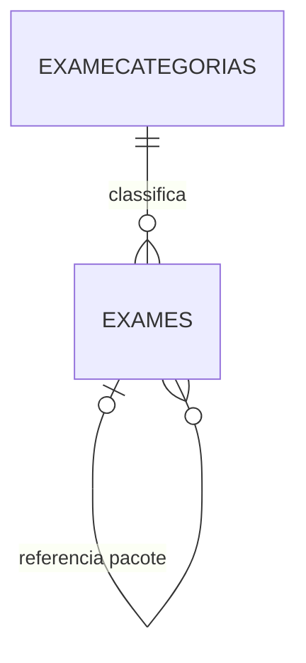

# Spec — revisão da estrutura do aplicativo LabVet

## Decisão de contexto

A base e as importações realizadas até aqui são uma POC de aprendizagem. Elas
não definem restrições para o aplicativo definitivo, não precisam ser
compatíveis e não serão usadas como referência para preservar nomes, chaves ou
relacionamentos.

O objetivo agora é estruturar o LabVet como aplicativo. A importação dos nove
anos será uma etapa posterior, feita contra o modelo aprovado e por uma rotina
auditável de carga.

## Convenção obrigatória de nomenclatura

Todo nome físico novo deve obedecer às regras abaixo:

| Elemento | Convenção | Exemplo |
| --- | --- | --- |
| Tabela | Português, minúsculas, sem `_` | `examecategorias`, `atendimentos` |
| Campo | Português, minúsculas, sem `_` | `idexamecategoria`, `dhinclusao` |
| Chave primária | `id` + entidade no singular | `idexame` |
| Chave estrangeira | Mesmo nome da PK referenciada | `idcategoriaexame` |
| Nome | Prefixo `nm` | `nmexame` |
| Código | Prefixo `cd` | `cdexame` |
| Quantidade | Prefixo `qt` | `qttotalexames` |
| Valor monetário | Prefixo `vl` | `vlexame` |
| Situação ou indicador lógico | Prefixo `st` | `stativo`, `stprimario` |
| Data e hora | Prefixo `dh` | `dhinclusao` |

Nomes em inglês, nomes mistos e sublinhados não são aceitos no novo modelo.

## Módulo: catálogo de exames

O catálogo passa a ser a fonte de cadastro dos serviços laboratoriais. Ele não
substitui preços ou totais históricos de um atendimento, pois esses valores
devem pertencer ao próprio atendimento quando a importação histórica existir.

### Tabela `examecategorias`

| Campo | Tipo | Regra |
| --- | --- | --- |
| `idexamecategoria` | `BIGINT` | PK. |
| `nmcategoria` | `VARCHAR(100)` | Obrigatório e único. |
| `stativo` | `BOOLEAN` | Obrigatório; padrão `true`. |
| `idusuarioinclusao` | `BIGINT` | Usuário que incluiu o registro. |
| `idusuarioalteracao` | `BIGINT` | Último usuário que o alterou. |
| `dhinclusao` | `TIMESTAMPTZ` | Obrigatório. |
| `dhalteracao` | `TIMESTAMPTZ` | Obrigatório; atualizado automaticamente. |

### Tabela `exames`

| Campo | Tipo | Regra |
| --- | --- | --- |
| `idexame` | `BIGINT` | PK. |
| `idexamecategoria` | `BIGINT` | FK obrigatória para `examecategorias`. |
| `cdexame` | `VARCHAR(50)` | Código do laboratório; obrigatório e único. Aceita códigos como `44/45` e `7.35`. |
| `nmexame` | `VARCHAR(200)` | Nome do exame; obrigatório. |
| `qttotalexames` | `INTEGER` | Total declarado no catálogo; mínimo 1. |
| `vlexame` | `NUMERIC(18,2)` | Valor cobrado pelo laboratório; pode ser nulo quando não informado. |
| `stprimario` | `BOOLEAN` | `true` para exame unitário; `false` para pacote. |
| `idexamepai` | `BIGINT` | FK autorreferente opcional, reservada à primeira representação de pacote. |
| `stativo` | `BOOLEAN` | Obrigatório; padrão `true`. |
| `idusuarioinclusao` | `BIGINT` | Usuário que incluiu o registro. |
| `idusuarioalteracao` | `BIGINT` | Último usuário que o alterou. |
| `dhinclusao` | `TIMESTAMPTZ` | Obrigatório. |
| `dhalteracao` | `TIMESTAMPTZ` | Obrigatório; atualizado automaticamente. |

## Pacotes

Os catálogos mostram que pacote é um conjunto de exames. A composição ainda
não foi fornecida e não deve ser inferida por preço ou quantidade total.

`idexamepai` foi incluído conforme solicitado, mas ele só representa uma
relação de pai para um filho. Como um mesmo exame pode participar de vários
pacotes, a composição definitiva exigirá uma terceira tabela associativa em
etapa própria: `itenspacoteexames`. Ela terá um pacote, um exame componente e
a quantidade do componente. Nenhuma composição será criada antes da validação
do laboratório.

## Categorias iniciais

O catálogo recebido indica, inicialmente: Bioquímico, Hematologia, Urinálise,
Outros Exames, Imunológico, Parasitológico, Pacotes, Hormonal, Citologia e
Outros. A carga inicial do catálogo será revisada antes de virar dado oficial.

## Implementação inicial

O script [001_catalogoexames.sql](../database/estrutura/001_catalogoexames.sql)
cria essas tabelas na base definitiva escolhida para a implantação. Ele não é
usado pelo contêiner da POC e não altera a base `labvet` existente.

O mesmo script passou a incluir os cadastros compartilhados `usuario`,
`pessoa`, `pessoaatividade`, `tipocontato` e `pessoacontato`, reproduzindo as
estruturas correspondentes do Itriax com a nomenclatura física adotada pelo
LabVet. `tipocontato` é necessário para manter a FK de `pessoacontato`.

`usuario` é uma especialização obrigatória de `pessoa`: `idpessoa` é uma FK
única em `usuario`. Nome e CPF pertencem apenas ao cadastro de pessoa; usuário
mantém os dados de autenticação e situação de acesso.

A migração [002_autenticacao.sql](../database/estrutura/002_autenticacao.sql)
adiciona `sessao` e `recuperacaosenha`, além da versão de segurança exigida em
`usuario` para invalidar sessões após ações sensíveis.

A migração [005_analitosexameanalitos.sql](../database/estrutura/005_analitosexameanalitos.sql)
adiciona o catálogo de parâmetros laboratoriais e a associação de analitos aos
exames, com uma faixa de referência padrão.

## Próximas decisões do modelo

1. Definir a tabela de usuários do modelo definitivo, para que
   `idusuarioinclusao` e `idusuarioalteracao` tenham FKs físicas.
2. Definir a estrutura de composição de pacotes.
3. Revisar os demais módulos com a mesma convenção: pacientes, responsáveis,
   atendimentos, laudos, resultados e importações.
4. Desenhar o modelo ER definitivo antes de criar a nova base.

## Critérios de aceite

- As duas tabelas existem no modelo proposto com os campos desta especificação.
- Todo nome novo está em português, minúsculo e sem `_`.
- `cdexame` é único, `qttotalexames` é maior que zero e valores negativos são
  recusados.
- Pacotes podem ser cadastrados sem que a composição seja inventada.
